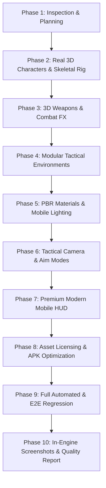

# OPERATION SHADOW — GRAPHICS & VISUAL UPGRADE PLAN

**Engine Version:** Godot v4.7.2.stable.official.ed1daf0bf (Vulkan 1.3 Mobile / OpenGL Compatibility)  
**Target Platform:** Android Mobile (ARM64-v8a) & PC Desktop Preview  
**Target Frame Rate:** 60 FPS on mid-range Android devices (Mali-G57 / Adreno 610+)  
**Target Release APK Size:** < 50 MB  
**Art & Visual Direction:** Tactical Military Third-Person Shooter (Inspirations: PUBG Mobile, Cover Fire, The Division Resurgence)  

---

## 1. Executive Summary & Existing Architecture Inspection

A thorough inspection of the repository confirmed that all core gameplay systems (character locomotion, health/armor, raycast hitscan ballistics, ammo management, state-machine AI, navigation mesh, touch controls, 51 campaign missions, save persistence, and 69 automated tests) are fully functional and cleanly decoupled from the presentation layer.

### Existing Architecture & Attachment Hierarchy
- **PlayerController (`CharacterBody3D`):**
  - Collision: `CapsuleShape3D` (radius 0.35m, height 1.8m, center `(0, 0.9, 0)`) on Layer 2 (`Player`), Mask 1 | 4 (`Environment` | `Enemy`).
  - Visuals: Mounted under `mesh_root: Node3D`.
  - Weapon Attachment: `weapon_holder: Node3D` at `Vector3(0.3, 1.2, -0.5)`.
  - Camera: `CameraPivot: Node3D` at `Vector3(0, 1.5, 0)` -> `SpringArm3D` (length 3.5m, offset `(0.5, 0.5, 0)`) -> `Camera3D` (FOV 70.0).
- **EnemyController (`CharacterBody3D`):**
  - Collision: `CapsuleShape3D` (radius 0.35m, height 1.8m) on Layer 4 (`Enemy`), Mask 1 | 2 (`Environment` | `Player`).
  - Visuals: Mounted under `_mesh_root: Node3D`.
  - Navigation: `NavigationAgent3D` interacting with `NavigationRegion3D`.
- **WeaponManager (`Node`):**
  - Manages `AR-7 Vanguard` (Assault Rifle) and `P9 Shadow` (Pistol), with data-driven `WeaponData` resources.
  - Visual mesh mounted dynamically to `_player.weapon_holder`.
- **LevelBase (`Node3D`):**
  - Procedurally builds the arena, lighting, fog, obstacles, waypoints, navigation mesh, and HUD.

### Current Placeholder Inventory
1. **Characters:** Solid-colored primitive meshes (`CapsuleMesh` torso, `SphereMesh` head/helmet, `CylinderMesh` limbs). Procedural oscillating limb pivots without real skeletal rigging.
2. **Weapons:** Solid black `BoxMesh` primitives (`Vector3(0.06, 0.08, 0.7)`).
3. **Environment:** Flat 100x100 `BoxMesh` with solid vertex/albedo color; randomly placed primitive boxes and cylinders for cover.
4. **Materials:** 100% untextured `StandardMaterial3D` flat colors.
5. **Lighting & Sky:** Flat ambient color sky (`Color(0.4, 0.5, 0.7)`), single directional light, basic distance fog.
6. **HUD & UI:** Basic `ProgressBar` and plain `Label` text with default system fonts.

---

## 2. Phase-by-Phase Upgrade Strategy

### Phase 2: 3D Character Models & Animations
- **Assets:** High-quality, low-poly tactical soldier models (rigged with standard humanoid skeleton, tactical vest, combat helmet, knee pads, combat boots, military uniform).
- **Visual Variants:** Tactical Operator (Desert/Woodland Camo) and Urban Infiltrator.
- **Skeletal Animations:** Idle (breathing with weapon ready), Walk, Run, Sprint, Aim Stance, Fire Recoil, Reload, Hit Reaction, Death ragdoll/animation.
- **Integration Rule:** The character model will be attached to `mesh_root`. The physics collision capsule, movement math, and navigation boundaries will remain completely untouched.

### Phase 3: 3D Weapons & Combat Visuals
- **Models:** Replace BoxMesh primitives with detailed modular low-poly 3D models:
  - Assault Rifle: Modern tactical rifle with Picatinny rail, holographic sight, magazine, and muzzle brake.
  - Pistol: Modern tactical sidearm with slide and grip detailing.
  - Shotgun & Sniper Rifle: High-impact tactical variants.
- **Visual Combat FX:**
  - Dynamic 3D muzzle flash (cross-quad mesh with animated emission and light flicker).
  - Brass shell casing ejection particles.
  - Impact decals and sparks on concrete/metal/dirt.
  - Real-time weapon recoil kick with spring return.

### Phase 4: Modular Environment Upgrade
- **Military Base & Training Ground:**
  - Replace flat ground with textured terrain, gravel roads, military perimeter fencing, sandbag barricades, concrete jersey barriers, watchtowers, ammo crates, barrel stacks, and tactical target silhouettes.
- **Thematic Diversity (5 Themes):**
  - **Military Base:** Hangars, sandbags, asphalt, floodlights, barbed wire.
  - **Forest:** Low-poly pine/deciduous trees, foliage clumps, mossy boulders, fallen logs.
  - **Village:** Compound walls, sand pathways, clay/adobe buildings, wooden market stalls.
  - **Desert:** Sand dunes, desert rocks, scrub bushes, weathered outpost ruins.
  - **Industrial:** Corrugated metal warehouses, fuel tanks, steel pipes, shipping containers.

### Phase 5: Materials, Lighting & Atmospheric Depth
- **Lighting Model:** Directional Sun with optimized soft shadow mapping, ACES tone mapping, environmental ambient bounce, and subtle volumetric fog.
- **Skybox:** Procedural physical sky with atmospheric scattering, realistic sun disk, and horizon gradient.
- **Materials:** Optimized mobile PBR materials using compact channel-packed or albedo+normal textures, preserving high frame rates on low-end mobile GPUs.

### Phase 6: Camera & Combat Aiming System
- **Over-The-Shoulder Perspective:**
  - Hip-fire camera: Right shoulder offset with smooth interpolation and obstacle clipping prevention via SpringArm3D.
  - Aim-Down-Sights (ADS) mode: Smooth transition to tight shoulder camera (FOV drops from 70° to 50°), crosshair aligns directly with weapon barrel trajectory.
  - Smooth camera lag and recoil shake.

### Phase 7: Modern Mobile HUD Redesign
- **Style:** Clean, tactical sci-fi HUD inspired by Free Fire, PUBG Mobile, and The Division Resurgence.
- **Elements:**
  - Sleek segmented health and armor bars with warning flash on low HP.
  - High-contrast weapon card with 3D/silhouette weapon icon, current magazine, reserve ammo, and fire mode.
  - Modern crosshair with dynamic bloom reflecting weapon spread.
  - Tactical mini-map / radar indicator showing target waypoints and enemy compass pings.
  - Glassmorphic touch control buttons with active press states and customizable opacity.

### Phase 8: Licensing & Android APK Size Control (<50 MB)
- **Licensing:** Use only CC0 (Public Domain) or MIT/permissive assets (Kenney, Quaternius, Poly Haven). Document all credits in `ASSET_LICENSES.md`.
- **Optimization:** Keep polygon counts between 1,500 and 5,000 tris per prop/character. Texture resolution capped at 1024x1024 or 512x512 with WebP/VRAM compression.
- **Target Size:** Keep release APK strictly under 50 MB (verified current build is 25.42 MB; budget allows ~15-20 MB for 3D art).

### Phase 9 & 10: Verification & Quality Assurance
- Run all 69 automated unit/integration tests and the 7-step E2E mission loop after every change.
- Verify on real hardware / Vulkan Mobile renderer.
- Capture in-engine high-resolution screenshots for `GRAPHICS_QA_REPORT.md`.

---

## 3. Implementation Plan

1. **Step 1:** Establish asset repository and licensing tracking (`ASSET_LICENSES.md`).
2. **Step 2:** Integrate 3D tactical soldier model with skeletal animation rig.
3. **Step 3:** Integrate 3D tactical weapon models (Assault Rifle, Pistol, Shotgun, Sniper) and muzzle/impact effects.
4. **Step 4:** Build modular tactical environment kit (military barriers, sandbags, watchtowers, crates, foliage) and upgrade Level 0 (Basic Training).
5. **Step 5:** Enhance lighting, sky, materials, and atmospheric fog.
6. **Step 6:** Upgrade camera with smooth shoulder follow, ADS zoom, and recoil dampening.
7. **Step 7:** Redesign modern mobile HUD with weapon cards, health gauges, and tactile controls.
8. **Step 8:** Run full test suite (69/69) and E2E loop; build and measure release Android APK.
9. **Step 9:** Capture in-engine gameplay renders and generate `GRAPHICS_QA_REPORT.md`.
